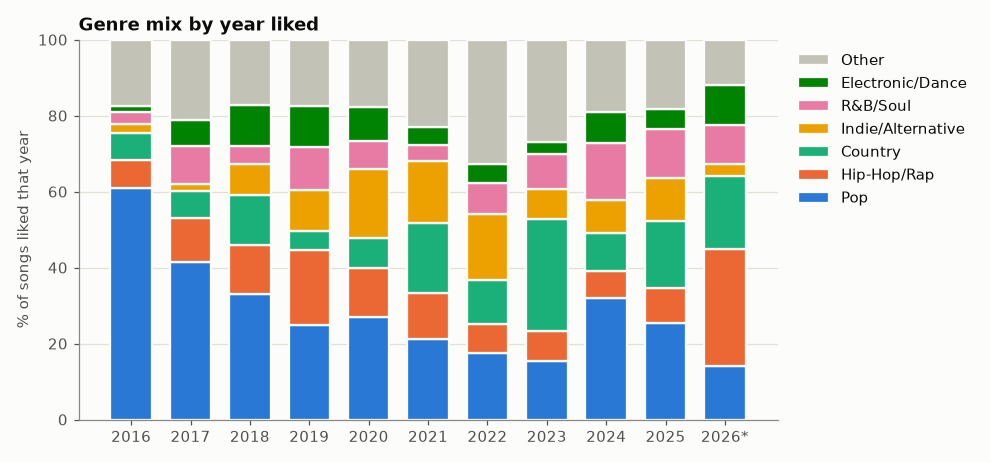
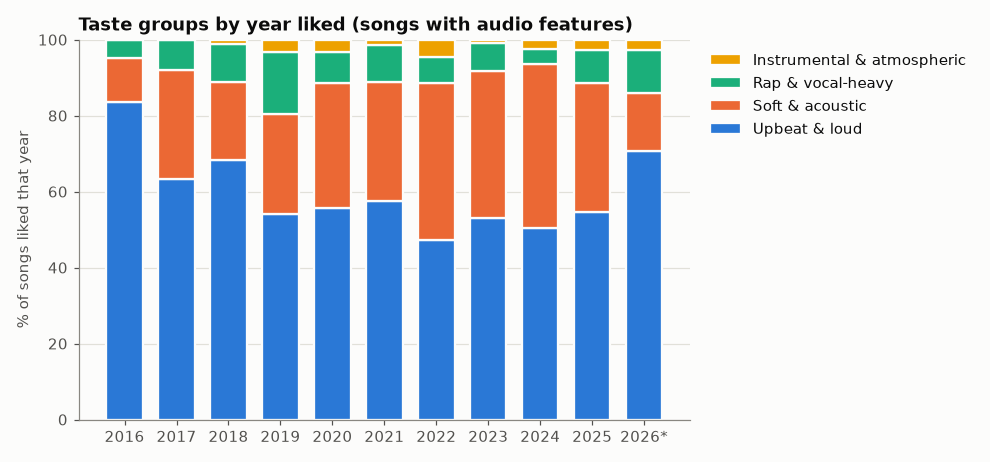
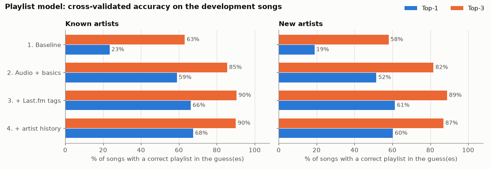

# What my Spotify Liked Songs say about my taste

A personal dataset built from my 5,261 Spotify Liked Songs (October 2015 to October 2026) and my 63 playlists, combined with audio features from ReccoBeats and listener data and tags from Last.fm. I used it to look at how my taste has changed, group my songs into taste clusters, and train a model that suggests which of my playlists a song belongs in.

This is a portfolio project for my MSBA program. It's one person's music library, so the findings describe me, not music in general.

## What's in this repo

| File | What it is |
|---|---|
| `pull_songs.py` | Pulls my Liked Songs from the Spotify Web API into `liked_songs_raw.csv` |
| `check_raw.py` | Sanity checks on the raw pull (row count, missing values, duplicates, local files) |
| `pull_artists.py` | Tries to get artist genres from Spotify. Spotify no longer provides them for new apps, so this mostly documents that (see below) |
| `pull_audio_features.py` | Gets audio features (danceability, energy, valence, etc.) from ReccoBeats into `audio_features.csv` |
| `pull_lastfm.py` | Gets listener counts, play counts, tags, and my own play counts from Last.fm into `lastfm_tracks.csv` and `lastfm_artists.csv` |
| `pull_playlists.py` | Pulls every song in the playlists I made into `playlist_tracks.csv` |
| `test_playlists.py` | The small test I ran to check what playlist data Spotify allows |
| `build_dataset.ipynb` | Cleans and merges everything and engineers features, saving `liked_songs_clean.csv` |
| `analysis.ipynb` | Taste over time, taste clusters, and a popularity model |
| `playlists.ipynb` | The playlist model, its validation, playlist suggestions, and my monthly playlists |
| `playlist_model.py` | Shared code for the playlist model (features, song matching, the model pipeline), used by the notebook and the predictor |
| `predict_playlist.py` | Predicts which of my playlists any song on Spotify belongs in (see below) |
| `models/playlist_model.joblib` | The trained model the predictor uses |
| `liked_songs_clean.csv` | The final dataset (data dictionary below) |
| `figures/` | Charts saved by the notebooks |

**About the data files:** only `liked_songs_clean.csv` is in this repo. The raw pulls and in-between files (my full playlists, Last.fm results, audio features, suggestions) stay on my computer since they're a detailed record of my listening. The notebooks are saved with their outputs, so every result is still visible here, but rerunning them needs those files (see "Running it yourself").

## How the data was collected

**Spotify Web API** (through `spotipy`, logged in with my own account). Liked Songs give title, artists, album, release date, length, explicit flag, and when I liked each song. Playlists give the same song details plus when each song was added.

Spotify changed what new "Development Mode" apps can access in 2024 and 2026, and a lot of what this project originally planned to use is no longer available. I tested each of these myself:

| Spotify data | Status for this app |
|---|---|
| Liked Songs | Works |
| Track popularity | Removed (comes back empty) |
| Artist genres, popularity, follower counts | Removed (the single-artist call works but leaves these out; the batch call returns 403) |
| Audio features (`sp.audio_features`) | Blocked (403) |
| Songs in playlists I made | Works through the newer `playlists/{id}/items` endpoint (the older `/tracks` one returns 403) |
| Songs in playlists made by other people | Blocked (403) |

To fill the gaps:

**ReccoBeats** (free API, no key). Accepts Spotify track IDs and returns Spotify-style audio features. These are ReccoBeats' own estimates, not Spotify's original numbers, and it only knows about some songs.

**Last.fm API** (free key). Last.fm doesn't use Spotify IDs, so songs are matched on artist name and track title. The script tries the title exactly as Spotify has it first, and if that fails, tries a cleaned version without "feat." credits or "- 2011 Remaster" style suffixes. It also fixes two quirks I ran into: Last.fm reads a "+" in a name as a space (so "Dan + Shay" was matching an almost empty duplicate page until I fixed the encoding), and it spells one artist "Axwell Λ Ingrosso" with a Greek letter. From Last.fm I get:
- how many people listen to each song and artist, and total plays (used for popularity, since Spotify's is gone)
- user-added tags like "indie folk" or "chill" (used for genre and mood, since Spotify's genres are gone)
- my own play counts (I joined Last.fm on December 4, 2024, so these only cover listening since then)

All API keys live in a local `.env` file that is not part of this repo. Every script saves as it goes and skips anything already looked up, so an interrupted run can just be restarted.

### Match rates

| Source | Matched | Notes |
|---|---|---|
| Last.fm songs (Liked Songs + playlists) | 6,767 of 6,768 | The one miss is credited to "Various Artists" |
| Last.fm artists | 1,669 of 1,669 | |
| Songs with their own Last.fm tags | about 26% of Liked Songs | Most songs have never been tagged, so they use their artist's tags instead |
| Songs with any tags (own or artist's) | 98.8% of Liked Songs | |
| ReccoBeats audio features | 70.8% of Liked Songs (after merging duplicates) | 65.6% of all songs looked up, including playlist songs |

A spot check of the Last.fm matches found no wrong titles. 56 songs came back under a different artist name, and all of them were the same act under another spelling (Kesha as "Ke$ha", Lady A as "Lady Antebellum").

## The main dataset: `liked_songs_clean.csv`

One row per song, 4,811 rows and 99 columns. Built in `build_dataset.ipynb`.

Two cleaning decisions matter for everything else:
- **Duplicate saves are merged.** 449 rows were the same song liked more than once (often the single and the album version). Each song keeps its earliest like date, plus a `times_saved` count. If one version was missing audio features and another had them, the gap is filled from the other version.
- **Times are my local time** (America/New_York), since Spotify gives them in UTC.

### Data dictionary

**From Spotify**

| Column | Meaning |
|---|---|
| `track_id`, `artist_id`, `album_id` | Spotify IDs |
| `track`, `artist`, `album` | Names. `artist` is the first-listed (main) artist |
| `all_artists`, `n_artists` | Every credited artist (separated by `|`) and how many |
| `album_type`, `album_total_tracks` | album, single, or compilation, and the album's track count |
| `release_date`, `release_date_precision` | Release date, and whether it's a full date, year and month, or only a year |
| `duration_ms`, `explicit` | Length in milliseconds, explicit flag |
| `added_at` | When I liked the song (local time) |
| `isrc` | International recording code (from ReccoBeats) |

**Audio features (ReccoBeats estimates, about 71% of songs)**

| Column | Meaning |
|---|---|
| `danceability`, `energy`, `valence`, `acousticness`, `speechiness`, `instrumentalness`, `liveness` | 0 to 1 scores. Valence is how positive the song sounds |
| `tempo`, `loudness` | Beats per minute, and average loudness in decibels |
| `key`, `mode` | Musical key (0 = C) and major (1) or minor (0) |

**From Last.fm**

| Column | Meaning |
|---|---|
| `lfm_match` | How the song was matched: `original` title, `cleaned` title, or `none` |
| `lfm_track_name`, `lfm_artist_name` | The names Last.fm matched to |
| `lfm_track_listeners`, `lfm_track_playcount` | People who've played the song, and total plays, across all Last.fm users |
| `lfm_artist_listeners`, `lfm_artist_playcount`, `lfm_artist_matched` | The same for the artist |
| `lfm_user_playcount`, `lfm_artist_user_playcount` | My own plays of the song and artist since December 2024 |
| `lfm_track_tags`, `lfm_artist_tags` | Top 5 tags for the song and the artist, separated by `|` |

**When I liked it**

| Column | Meaning |
|---|---|
| `liked_year`, `liked_month`, `liked_dow`, `liked_hour` | Year, month, day of week, and hour I liked it |
| `release_year`, `release_decade` | When the song came out |
| `song_age_when_liked` | Years between release and when I liked it (0 if I liked it before release) |
| `days_since_liked` | Days from liking it to October 20, 2026 (the pull date) |
| `songs_liked_that_day`, `binge_day` | How many songs I liked that day, and whether that day was in my top 5% (8 or more songs) |
| `days_release_to_like`, `liked_first_week` | Days from release to when I liked it, and whether that was within 7 days. Only for songs with an exact release date. Negative means a pre-save |
| `times_saved` | How many times the song appears in my Liked Songs |

**Artist and album**

| Column | Meaning |
|---|---|
| `my_songs_by_artist` | How many of my liked songs are by this artist |
| `is_new_artist` | This was my first liked song by this artist. My earliest likes are almost all "new" by definition |
| `is_collab`, `is_single` | More than one artist, and released as a single |
| `album_share_liked` | Share of the album's tracks that I've liked |

**Genre and tags**

| Column | Meaning |
|---|---|
| `tags`, `tag_source` | The tags used for this song: its own if it has any (`track`), otherwise its artist's (`artist`) |
| `main_genre` | One of 11 genre buckets (Pop, Hip-Hop/Rap, Country, Indie/Alternative, R&B/Soul, Electronic/Dance, Folk/Acoustic, Rock, Soundtrack/Musical, Jazz/Blues, Christian) or Unknown. Picked from the most-used tag that fits a bucket |
| `genre_count` | How many different buckets the song's tags touch |
| `tag_pop`, `tag_hip_hop`, `tag_indie`, ... (15 columns) | Yes/no flags for the 15 most common tags |

**Popularity** (all based on Last.fm listeners, since Spotify's popularity score is gone)

| Column | Meaning |
|---|---|
| `log_track_listeners`, `log_track_playcount` | log10 of listeners and plays (3 = a thousand, 6 = a million) |
| `popularity_tier` | low / mid / high, splitting my songs into thirds by listeners |
| `niche_score` | Song listeners compared with the artist's, on the log scale. Near 0 = one of the artist's big songs, very negative = a deep cut |
| `mainstream_score`, `hidden_gem` | 0 to 100 rank of my songs by listeners and plays combined, and a flag for the bottom 20 |
| `replays_per_listener` | Total plays divided by listeners |
| `artist_size` | Artist listeners bucketed: under 100K, 100K-1M, 1M-3M, 3M+ |

**Mood and sound**

| Column | Meaning |
|---|---|
| `mood_quadrant` | From valence and energy: upbeat (both high), intense (low valence, high energy), sad (both low), calm (high valence, low energy) |
| `mood_from_tags` | calm, sad, upbeat, or romantic, from mood tags like "chill" or "sad" (only about 3% of songs have one) |
| `mood`, `mood_source` | The audio quadrant if available, otherwise the tag mood, and which one was used |
| `tempo_bucket` | slow (under 90 BPM), moderate, upbeat, fast (140+) |
| `party_score` | Average of danceability and energy |
| `novelty` | How different the song sounds from what I'd liked in the 6 months before it (distance from that average, in standardized units). Blank if there were fewer than 20 songs to compare to |

**Title**

| Column | Meaning |
|---|---|
| `title_length`, `title_words` | Characters and words in the title |
| `has_feat`, `is_remix`, `is_live` | Title mentions a featured artist, a remix, or a live recording |

**My listening (Last.fm, since December 2024)**

| Column | Meaning |
|---|---|
| `liked_after_lastfm` | I liked the song after joining Last.fm |
| `played_since_lastfm` | I've played it at least once since joining. A false here doesn't mean I never played it |
| `plays_per_month` | My plays divided by the months the song could have been counted (from liking it or joining Last.fm, whichever came later). Blank if that window is under a month |

### Other output files (kept local, not in this repo)

- **`playlist_tracks.csv`**: one row per song per playlist (13,596 rows) for my 63 playlists. Includes `playlist`, `added_to_playlist`, and the same song details as above.
- **`playlist_suggestions.csv`**: for 2,501 Liked Songs that aren't in any of my vibe playlists, the model's `suggested_playlist` with its `confidence` (0 to 1) and a `runner_up`.

## What I found

From `analysis.ipynb`:

- **I liked the most songs in 2019** (1,029) and much fewer from 2021 on.
- **Pop went from about 60% of what I liked in 2015-16 to 14% so far in 2026.** Nothing replaced it steadily: indie had a moment around 2020-2022, country spiked in 2023, and 2026 is my most hip-hop-heavy year so far (31%).
- **The mood of what I like barely changes.** Median valence stays between 0.43 and 0.49 every year. Energy is what moves: it dipped to its lowest in 2022 and is back up in 2026.
- **2022 to 2024 was my soft and acoustic era**, about 40% of what I liked, compared with 11% in 2015-16.
- **I discover fewer new artists than I used to.** In 2015-16, 42% of my likes were my first song by that artist. That fell to 20% by 2024 and is back up to 28% in 2026.
- **Four taste clusters** based on sound: Upbeat & loud (58%), Soft & acoustic (30%), Rap & vocal-heavy (10%), and a small Instrumental & atmospheric group (2%). The clusters overlap a lot (silhouette score about 0.24), so they're better read as regions of my taste than separate boxes.
- **Who the artist is matters more for popularity than how the song sounds.** A model using only the song's sound and basic facts predicts whether it's in my top third by listeners with an AUC of about 0.75. Adding the artist's listener count raises that to about 0.87.





## The playlist model

`playlists.ipynb` trains a model to guess which of my "vibe" playlists a song belongs in, using its audio features, basic facts (release year, length, explicit, and so on), Last.fm popularity, my own plays, and its Last.fm tags. I merged some playlists that I use the same way into 8 labels: Country, Hip Hop/Rap, Cute, Fall, Boat Songs, Hype, Sad Vibes, and Sunset. Time-based playlists (monthly ones, seasons, trips) aren't used as answers, since a new song could never belong in "Feb20". The notebook looks at those separately.

The model then suggests a playlist for each Liked Song I never sorted (`playlist_suggestions.csv`). Some of the top suggestions: Caamp songs for Fall, Cardi B for Hip Hop/Rap, and house remixes for Hype.



## Validation approach and limitations

**How the playlist model was checked**

- **One row per song.** The same song often appears as several Spotify tracks: single and album versions, remasters, "feat." credits, Taylor's Versions. I merged these using a cleaned-up title plus the primary artist, which turned 2,670 labeled tracks into 2,458 songs. Without this step, the model could be tested on a near copy of a song it had already trained on.
- **A locked final test set.** Before building any models, I set aside 15% of the songs (311 songs by 132 artists). No artist appears in both the test set and the training data. I scored this set once, after choosing the final model.
- **Two kinds of cross-validation on the other 85%.** "Known artists" splits songs at random, so the model has usually seen other songs by the same artist. "New artists" keeps all of an artist's songs on the same side of the split.
- **No peeking inside each split.** The list of tags used as features and the artist-history feature are both built from the training songs only, inside a scikit-learn pipeline.
- **Artist history without leaks.** My first version of this feature used leave-one-out encoding, which leaks the answer. It scored lower than the fixed version (64.0% vs. 67.4% top-1). The final version computes it with a separate split inside the training data.
- **The choice was made in advance.** The rule for picking the final model was set before looking at the test set: highest new-artist top-1 accuracy, with the simpler model winning if two were within 1 point. That picked the model with audio, basics, and Last.fm tags, without artist history.

**Results** (top-1 = the first guess is correct; top-3 = a correct playlist is in the top 3)

| | Top-1 | Top-3 | Always guess the biggest playlists |
|---|---|---|---|
| Cross-validation, known artists | 66% | 90% | 23% / 63% |
| Cross-validation, new artists | 61% | 89% | 19% / 58% |
| Final test (new artists) | 55% | 84% | 21% / 54% |

Country is the easiest playlist to predict and Fall, Cute, and Sunset are the hardest. The most common mix-ups are Fall songs guessed as Sad Vibes, Sunset as Fall, and Cute as Sad Vibes.

**Limitations of the playlist model**

- The final test score is lower than cross-validation (55% vs. 61% top-1). The test set is one random group of 132 artists, and its mix is different: fewer Country songs (the easiest playlist) and more Hip Hop/Rap. I report it as it came out rather than re-drawing the split.
- The labels are my own and they overlap. 29% of songs are in more than one playlist, and Fall and Sunset share many songs, so some "wrong" guesses are reasonable ones.
- The suggestions are ranked guesses for me to check, not answers. Each playlist gets its own probability, so the numbers aren't directly comparable across playlists.

## Predicting a playlist for any song

`predict_playlist.py` scores any song on Spotify, including ones I've never heard:

```
python predict_playlist.py "Espresso" "Sabrina Carpenter"
python predict_playlist.py "https://open.spotify.com/track/1k2pQc5i348DCHwbn5KTdc"
```

It looks the song up on Spotify, ReccoBeats, and Last.fm (with the same matching rules as the data pull), builds the same features the model trained on, and ranks my 8 playlists. Each playlist is scored on its own, so the percentages don't add up to 100%, and it always gives a ranking, even for a song that fits none of them (low scores across the board are the hint).

**The predictor uses a slightly different model than the one tested above.** The tested model includes two features about me rather than the song: whether it's in my Liked Songs and my Last.fm play count. A song I've never heard always looks like "not liked, 0 plays", which in training mostly showed up in two older playlists, so those features could push every new song toward them. The predictor drops those two features. I made this change after seeing the final test result, so this version is checked with cross-validation only, not the final test:

| Cross-validation (development songs) | Tested model | Predictor version |
|---|---|---|
| Known artists, top-1 / top-3 | 66% / 90% | 64% / 89% |
| New artists, top-1 / top-3 | 61% / 89% | 61% / 87% |

The two versions give the same top suggestion for 80% of my unsorted Liked Songs. As a sanity check (not a real test, since these songs were in the training data), it ranked the playlist I actually used first for five songs I'd already sorted.

## Limitations of the dataset overall

- **Audio features are estimates and incomplete.** They come from ReccoBeats, not Spotify, and are missing for about 30% of my songs. Some are clearly off (two vocal Khalid songs land in my "instrumental" cluster).
- **Tags are crowd-sourced and noisy.** Anyone on Last.fm can add them, most songs have none of their own, and three-quarters of my songs use their artist's tags instead. Song-level tags and the audio-based mood agree only about a third of the time.
- **"Popular" means popular with Last.fm users.** Only 10% of my country songs land in my top popularity third, compared with 39% of everything else. That's very likely about who uses Last.fm rather than about country music.
- **My play counts only start in December 2024**, when I joined Last.fm, and they include plays from before I liked a song.
- **Name matching isn't perfect.** Last.fm is matched on names, not IDs. The spot checks looked clean, but a few songs could be matched to a different version.
- **Spotify's restrictions shaped the project.** Without Spotify's own genres, popularity, and audio features, those all come from other sources, and playlists made by other people couldn't be used at all.
- **This is one person's library.** Nothing here should be read as a claim about music or listeners in general, and the patterns are associations, not causes.

## Running it yourself

1. Create a Spotify app at developer.spotify.com with the redirect URI `http://127.0.0.1:8888/callback`, and get a Last.fm API key at last.fm/api.
2. Make a `.env` file in this folder with `SPOTIPY_CLIENT_ID`, `SPOTIPY_CLIENT_SECRET`, `SPOTIPY_REDIRECT_URI`, and `LASTFM_API_KEY`. Change `LASTFM_USER` in `pull_lastfm.py` to your Last.fm username.
3. Install the packages: `pip install -r requirements.txt` (the saved model needs this exact scikit-learn version to load)
4. Run, in order: `pull_songs.py`, `pull_playlists.py`, `pull_audio_features.py`, `pull_lastfm.py`. The playlist and Last.fm scripts have a `--test` option for a small trial run, and the audio and Last.fm scripts pick up where they left off if stopped. The Last.fm pull takes a couple of hours at about one lookup per second.
5. Run the notebooks in order: `build_dataset.ipynb`, `analysis.ipynb`, `playlists.ipynb`.

The first Spotify script opens a browser window to log in. The login is saved in `.cache`, which is also kept out of the repo.

To just try the predictor with my trained model, you only need steps 1 to 3 (no login, no data pull) and then `python predict_playlist.py "Song" "Artist"`. Keep in mind it predicts *my* playlists.
